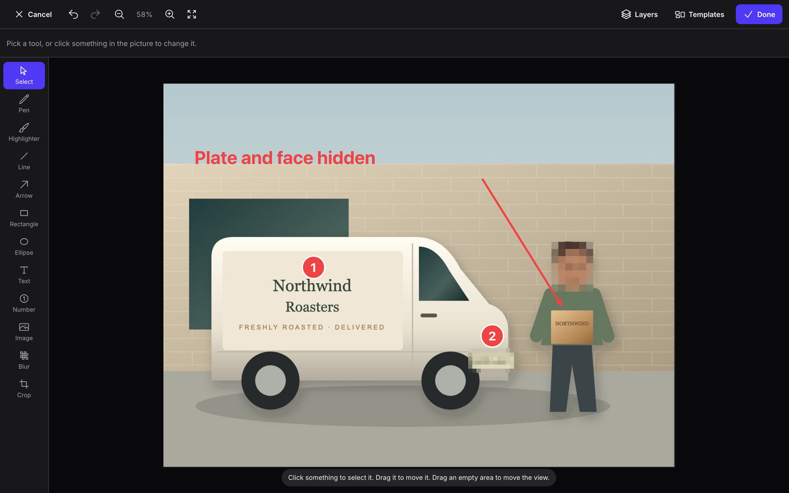
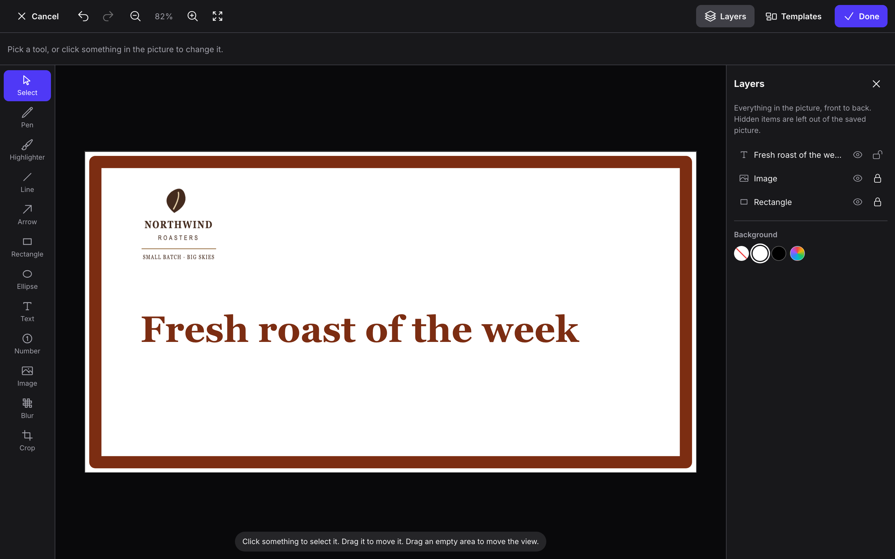
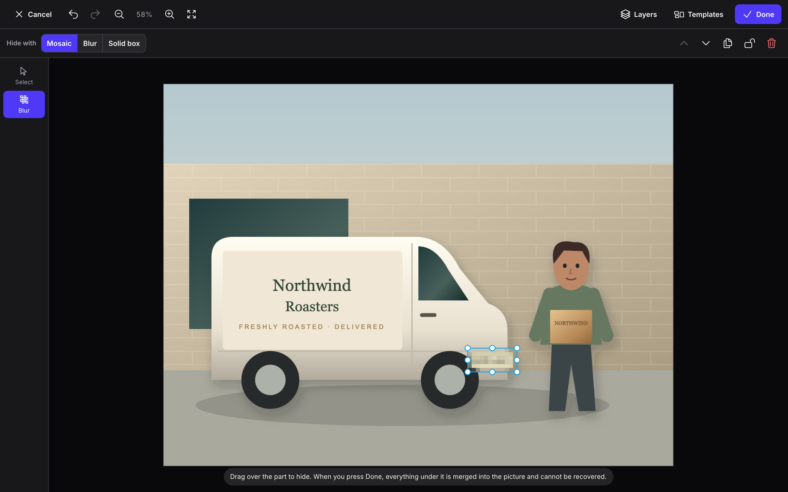

# Warp Painter

**Draw on the pictures in your Filament upload fields. Add one line to a `FileUpload` (or a `SpatieMediaLibraryFileUpload`) and the pencil button of every uploaded picture opens a full-screen editor: arrows, shapes, text, numbered markers, logos, blurred areas that stay hidden, cropping, layers you can edit again later, and templates shared with your team. Press Done and the picture goes back into the field like any other file.**

<a href="https://demo.warpui.com/painter"></a>

Mark up a photo with an arrow and numbers, hide a number plate for good, and start a banner from a shared template — at **[demo.warpui.com/painter](https://demo.warpui.com/painter)**. No sign-up needed; the data is reset every hour.

```php
use Filament\Forms\Components\FileUpload;

FileUpload::make('photo')
    ->image()
    ->painter(),
```

Works with Filament 5.11+, Laravel 11.28+, PHP 8.3–8.5, and SQLite, MySQL, MariaDB and PostgreSQL.

## Contents

- [What it does](#what-it-does)
- [Installation](#installation)
  - [AI coding assistants (Laravel Boost)](#ai-coding-assistants-laravel-boost)
- [Quick start](#quick-start)
- [Settings](#settings)
  - [Tools](#tools)
  - [Colors](#colors)
  - [Sizes](#sizes)
  - [Form values in text](#form-values-in-text)
  - [Logos and stamps](#logos-and-stamps)
  - [Fonts](#fonts)
  - [Templates](#templates)
  - [New pictures](#new-pictures)
  - [Output](#output)
- [How pictures stay editable](#how-pictures-stay-editable)
  - [Cleaning up](#cleaning-up)
- [Hiding parts of a picture](#hiding-parts-of-a-picture)
- [Tenancy](#tenancy)
- [Security](#security)
- [Keyboard](#keyboard)
- [Translations](#translations)
- [Good to know](#good-to-know)
- [Testing](#testing)
- [Static analysis (PHPStan / Larastan)](#static-analysis-phpstan--larastan)
- [Support](#support)
- [License](#license)

## What it does



| You want… | Use |
| --- | --- |
| Mark up a photo: arrows, lines, boxes, circles, freehand, highlighter | The drawing tools (all on by default) |
| "See ① and ②" — numbers that count up by themselves | The **Number** tool |
| Text on a photo that stays readable: outlined, in a box, in a rounded label | The **Text** tool and its styles |
| Hide a face, a plate or a price — for good | The **Blur** tool: [mosaic, blur or a solid box, burned in on Done](#hiding-parts-of-a-picture) |
| Crop to a shape, or to exactly 1200 × 630; rotate | The **Crop** tool and [`sizes()`](#sizes) |
| A banner or a diagram from scratch, without leaving the form | The **New picture** button under the field |
| The product name and price from the form, printed on the banner | [`fields()`](#form-values-in-text) |
| The company logo, one click away | [`images()`](#logos-and-stamps) |
| The same frame on every picture, made once by someone who can design | [Templates](#templates) |
| Move the arrow tomorrow instead of drawing everything again | [Layers that are kept](#how-pictures-stay-editable) (on by default) |
| Only the tools a field needs | [`tools()`](#tools) |

Every field with `->painter()`:

- **is still a normal upload field.** The disk, directory, validation, `multiple()`, `reorderable()`, the Spatie Media Library collection: nothing changes. Painter hands the finished picture to the field and the field uploads it.
- **replaces Filament's built-in image editor** on that field (the crop window). The pencil button opens Painter instead.
- **works with a mouse, a pen and fingers**, from a phone to a wide screen. Pinch to zoom, drag with two fingers to move the view.
- **loads its JavaScript only on pages that have such a field** (about 80 KB, no dependencies).
- **speaks ten languages**: English, Japanese, German, French, Spanish, Italian, Brazilian Portuguese, Korean, simplified and traditional Chinese.
- **follows Filament tenancy.** Layers and templates belong to the tenant they were made in.

## Installation

> **Warp Painter is a commercial plugin.** A license is required. After purchase you receive credentials for the private Composer repository.

```bash
composer config repositories.qalainau composer https://qalainau.privato.pub/composer
composer config --auth http-basic.qalainau.privato.pub "your-email" "your-license-key"

composer require qalainau/filament-warp-painter
php artisan migrate
php artisan filament:assets
```

> Run `php artisan filament:assets` again after every update of the package.

`php artisan migrate` creates two tables, `warp_painter_documents` (the layers of each picture) and `warp_painter_templates`.
Your own tables are not touched. If you turn layers and templates off on every field
([`reeditable(false)`](#how-pictures-stay-editable), [`templates(false)`](#templates)), nothing is ever written to them.

That is all. `->painter()` is now available on every `FileUpload`. Registering the plugin on a panel is optional and only
needed to change the panel-wide settings:

```php
use Qalainau\FilamentWarpPainter\FilamentWarpPainterPlugin;

$panel->plugin(
    FilamentWarpPainterPlugin::make()
        ->disk('s3')                                              // where the pictures behind the layers are kept
        ->canManageTemplates(fn ($user) => $user?->is_admin),     // who may save and delete templates
);
```

### AI coding assistants (Laravel Boost)

Warp Painter ships instructions for AI coding assistants such as Claude Code, Cursor and Codex. If your app uses [Laravel Boost](https://laravel.com/docs/boost), the assistant learns from them how to configure the editor on upload fields, which method does what, and how to test it.

- **Guidelines** (`resources/boost/guidelines/core.md`): a short summary that Boost adds to `CLAUDE.md`, `AGENTS.md` and the other agent files.
- **Skill** `warp-painter-development` (`resources/boost/skills/`): an example for every part. The assistant loads it when it works on a Painter upload field.

When `php artisan boost:install` asks "Which third-party AI guidelines/skills would you like to install?", select `qalainau/filament-warp-painter`. To do it without the question, add the package to `boost.json` and run the command again:

```json
{
    "packages": ["qalainau/filament-warp-painter"]
}
```

```bash
php artisan boost:install --guidelines --skills -n
```

## Quick start

```php
use Filament\Forms\Components\FileUpload;
use Filament\Forms\Components\SpatieMediaLibraryFileUpload;
use Qalainau\FilamentWarpPainter\Painter;

// Everything on: all tools, templates, layers that are kept.
FileUpload::make('photo')->image()->painter();

// Inspection photos: only annotation tools, no templates, no "New picture" button.
FileUpload::make('photos')
    ->image()
    ->multiple()
    ->painter(fn (Painter $painter) => $painter
        ->tools(['arrow', 'marker', 'text', 'redact', 'crop'])
        ->templates(false)
        ->newPicture(false));

// Banners: fixed sizes, the form values in the text, the logo, JPEG output.
FileUpload::make('banner')
    ->image()
    ->painter(fn (Painter $painter) => $painter
        ->sizes(['Banner' => [1200, 630], 'Square post' => [1080, 1080]])
        ->fields(['title', 'price' => 'Price'])
        ->images(['Logo' => asset('img/logo.png')])
        ->templates('banners')
        ->output('jpeg', 0.9));

// Spatie Media Library works the same way.
SpatieMediaLibraryFileUpload::make('attachments')->collection('attachments')->painter();
```

`painter()` takes a closure that receives the `Painter` settings of that field, a `Painter` object
(`->painter(Painter::make()->tools([...]))`), or nothing. Every setting also accepts a closure, evaluated like any other
Filament field setting (`$get`, `$record`, `$livewire`… are injected):

```php
->painter(fn (Painter $painter) => $painter->tools(fn (Get $get) => $get('is_draft') ? null : ['crop']))
```

How people use it:

- **Edit a picture:** upload it, then press the pencil button on its preview.
- **Draw a new one:** press **New picture** under the field, pick a size (or a template).
- **Done** puts the picture into the field. **Cancel** (or `Esc`) closes the editor; if something was changed, it asks first.
- The form is saved with its own Save button, as always. Until then the picture is an ordinary pending upload.

## Settings

### Tools

```php
$painter->tools(['pen', 'arrow', 'text', 'redact']);
```

`select` is always there. The others: `pen`, `highlighter`, `line`, `arrow`, `rect`, `ellipse`, `text`, `marker` (numbers),
`image`, `redact` (blur) and `crop`. Without `tools()`, all of them are offered. Unknown names are ignored.

Line widths and text sizes follow the size of the picture: **M** is a comfortable thickness on a 800 px screenshot and on a
4000 px photo alike.

### Colors

```php
$painter->colors(['#e11d48', '#0f172a', '#ffffff']);
```

The swatches of the color bar, as 6-digit hex colors. People can always pick another color with the last, rainbow swatch.

### Sizes

```php
$painter->sizes(['Banner' => [1200, 630], 'Story' => [1080, 1920]]);
```

Used in two places: the sizes offered for a **new picture**, and the shapes offered by the **Crop** tool. Cropping to a named
size makes the picture exactly that size (a 1600 × 1200 photo cropped to *Banner* becomes 1200 × 630). Without `sizes()`, five
common sizes are offered.

### Form values in text

```php
$painter
    ->fields(['title', 'price' => 'Price'])          // other fields of the same form
    ->values(['shop' => config('app.name')]);        // anything else
```

Text in a picture may contain `{title}`. Where the picture is drawn, the name is replaced with the value of that form field;
the text itself keeps the name. So when the title of the product changes, opening the banner and pressing Done is enough to
update it — nobody retypes anything. The text tool shows an *Insert a form value…* list with the names you allowed.

- `fields()` takes the names of fields in the same form (relative to the upload field, like `$get()`), optionally with the label
  shown in the list. Their values are read **in the browser, when the editor opens and again when Done is pressed**, so they
  include what was typed but not saved yet.
- `values()` takes fixed values (or a closure). They are evaluated when the page is rendered.
- A name without a value is left as it is (`{title}`), so a typo is visible instead of silently empty.

### Logos and stamps

```php
$painter->images(['Logo' => asset('img/logo.png'), 'Approved' => asset('img/approved.png')]);
```

With `images()`, the **Image** tool first offers these pictures, and a button to choose a file from the device. Without it,
the tool opens the file chooser directly. Pictures can also be pasted (`Ctrl/Cmd+V`) or dropped onto the editor. Use URLs of
your own site (or a host that sends CORS headers); other URLs cannot be drawn into a picture by the browser.

### Fonts

```php
$painter->fonts(['Inter', 'Brand' => '"Noto Serif JP", serif']);
```

Adds fonts to the sans-serif / serif / monospace choices of the text tool. The font must already be loaded on the page (for
example with `$panel->font()` or your own CSS); Painter does not load font files.

### Templates



A template is a set of items — a frame, a headline, a logo — that someone saved from the editor for everybody. Templates
appear in two places: on the start screen of a **new picture** (the picture gets the size and items of the template), and in
the **Templates** list of the editor (the items are added on top of the current picture, scaled to fit it).

```php
$painter->templates('banners');            // this field uses the list called "banners"
$painter->templates(false);                // no templates on this field
$painter->canManageTemplates(fn () => auth()->user()->can('manage templates'));
```

- Fields that pass the same name share one list. Without a name, the list is `default`.
- **Saving a template** keeps everything except the photo that was opened and blurred areas: you can design a frame on top of a sample photo and the photo stays out of it.
- Items that are **locked** when the template is saved stay locked for everyone who cannot manage templates: they can use the frame but not move or delete it. (This is a guard against accidents, not a security boundary — the result is a picture made in the browser.)
- Who may save and delete templates: `canManageTemplates()` on the field, or for the whole panel on the plugin. By default, everyone who is logged in. The check is made on the server.
- Templates may contain [form values](#form-values-in-text): a `{title}` in a template shows the title of whatever record it is used on.

### New pictures

```php
$painter->newPicture(false);   // hide the "New picture" button
```

### Output

```php
$painter->output('webp', 0.85);   // 'auto' (default), 'png', 'jpeg' or 'webp'; quality for JPEG and WebP
$painter->maxSize(2400);          // the longest side, in pixels (default 4096, at most 8192)
```

With `auto`, an edited picture keeps the type of the file that was opened, and a new picture is a PNG — or the first of PNG,
JPEG and WebP that the field accepts, when it has `acceptedFileTypes()`. If the field refuses the finished picture (its type or
its `maxSize()`), the editor says so and stays open; the picture that was in the field is not removed. A photo larger than
`maxSize()` is scaled down when it is opened. EXIF data (camera, GPS position) is not copied into the edited picture.

If the upload field resizes pictures before upload (`imageResizeTargetWidth()` and friends), that step is skipped for
pictures coming from Painter — use `maxSize()` and `sizes()` instead.

## How pictures stay editable

When Done is pressed, Painter saves the items of the picture (the *layers*) on your server and writes a short random ID into
the picture file itself — a `tEXt` chunk in a PNG, a comment in a JPEG, a private chunk in a WebP. The picture looks the same
and is a perfectly normal file.

When the pencil is pressed on a picture, Painter reads that ID from the file and asks the server for the layers. This is why
it keeps working after Filament renamed the file, after it moved to S3 or into a Media Library collection, and for every
copy of the file — and why there is nothing to configure per model.

What to know:

- The layers are found only while the file is **byte-for-byte the one Painter made**. If something re-encodes the original (an image optimizer that rewrites originals, a CDN that serves a converted file from the same URL), the ID is gone and the picture opens as a flat photo. Conversions and thumbnails next to an untouched original are fine.
- Each Done makes a new record; older versions of the picture keep theirs.
- Behind the layers, Painter keeps the pictures they use (the opened photo, logos) in `warp-painter/assets` on the default disk, under the hash of their contents. They are private: the editor reads them through signed links that expire. Change the disk with `FilamentWarpPainterPlugin::make()->disk('…')`.
- If the layers cannot be loaded for a passing reason (no connection, the page was open for more than a day), the picture is not opened and the field asks to reload the page — opening it flat and pressing Done would bake the arrows into the photo.
- People who are not logged in can still edit pictures, but nothing is kept on the server for them.

To keep nothing on the server for a field:

```php
$painter->reeditable(false);
```

The picture is then flattened: it looks the same, but opening it again shows one photo.

### Cleaning up

Painter cannot know that a form was closed without saving, or that a picture was deleted later. Schedule the clean-up command
to remove layers nobody opened for a while, and stored pictures no layer or template uses:

```php
Schedule::command('warp-painter:prune --days=180')->weekly();
```

Only the editing data is removed, never an uploaded picture. A picture whose layers were removed opens as a flat photo.
`--dry-run` reports what would be deleted. `--panel=` picks the panel whose disk setting is used (the default panel if left out).

## Hiding parts of a picture



The **Blur** tool hides a rectangle with a mosaic, a blur or a solid box. Until Done is pressed, the area is an item like any
other: it can be moved, resized and deleted.

On Done, everything under the topmost blurred area is merged into one picture, and only that merged picture is kept. The
original pixels are not in the saved file, not in the layers, and not in the pictures stored for the layers. Items above the
blurred area (an arrow, a note) stay editable.

If the picture had been edited and saved before without a blur, its earlier layers and the unblurred photo behind them are
deleted from the server at the same moment (all the way back through its earlier edits), so an older copy of the file can no
longer be opened into the unblurred photo.

Two things are outside Painter's reach: **files your app already stored** — the original upload or an earlier edited version,
if the form had been saved with it (replacing the file in the field does not delete the old file from your disk unless your
app does) — and how well a mosaic hides what is under it. For text that must not be recovered — a number plate, a card
number — use the **solid box**.

A template never includes a blurred area or anything under it.

## Tenancy

In a panel with Filament tenancy, layers and templates are stored with the tenant and only visible inside it; a picture made
in one tenant opens as a flat photo in another. Nothing needs to be configured.

If your app separates customers without Filament tenancy, name the key yourself:

```php
FilamentWarpPainterPlugin::make()->tenantKeyUsing(fn () => auth()->user()?->company_id)
```

If tenancy is added to an app that already has layers and templates, give the existing rows to a tenant once:

```bash
php artisan warp:assign-tenant "App\Models\Team" 1 --dry-run
```

## Security

- The editor talks to the server with a token that is created when the field is rendered. It is encrypted, bound to the logged-in user and the tenant, and expires after 24 hours (reload the page to continue after that). What a user may do — keep layers, use templates, manage templates — is decided on the server when the field is rendered, not by the browser.
- Layers are stored as data with a fixed shape: unknown keys are dropped, colors must be hex colors, and stored pictures must be PNG, JPEG or WebP files (checked by their contents; SVG is converted to PNG in the browser before it is stored).
- The ID in a picture is 32 random characters. Knowing it is not enough: opening layers also needs a login in the same tenant.

## Keyboard

| Key | Does |
| --- | --- |
| `V` `P` `H` `L` `A` `R` `O` `T` `N` `I` `B` `C` | Select, Pen, Highlighter, Line, Arrow, Rectangle, Ellipse (O), Text, Number, Image, Blur, Crop |
| `Ctrl/Cmd+Z`, `Ctrl/Cmd+Shift+Z` | Undo, redo |
| `Delete`, `Ctrl/Cmd+D` | Delete, duplicate the selected item |
| Arrow keys (`Shift` for bigger steps) | Move the selected item |
| `[` `]` | Send backward, bring forward |
| `Enter` | Edit the selected text; apply the crop |
| `Ctrl/Cmd+Enter` | Finish typing |
| `Shift` while drawing | Straight lines, squares and circles; keep proportions |
| `Space` + drag, wheel, `Ctrl/Cmd` + wheel | Move the view, scroll, zoom |
| `Esc` | Stop what you are doing; deselect; close |

## Translations

Publish the language files to change the wording:

```bash
php artisan vendor:publish --tag=filament-warp-painter-translations
```

## Good to know

- `->painter()` calls `imageEditor()` on the field and adds an `x-init` attribute through `extraAlpineAttributes()`. If you set `extraAlpineAttributes()` yourself, do it before `->painter()` or pass `merge: true`.
- Painter needs the image preview of the upload field (it is on by default; `previewable(false)` hides the pencil button).
- A disabled field shows no pencil and no New picture button.
- Inside a `Repeater` or `Builder`, every item gets its own editor with the same settings.
- Pictures are drawn in the browser, so text is rendered with the fonts of the device of the person pressing Done.
- Files that are not PNG, JPEG, WebP, GIF or SVG pictures cannot be opened in the editor.
- Pressing Done replaces the picture you opened: the edited picture takes the same place in the field (also with `multiple()` and `reorderable()`). The file that was uploaded before is not deleted from the disk, the same as when you remove a picture from any Filament upload field. To delete it, use `deleteUploadedFileUsing()` on the field.

## Testing

```bash
composer test     # Pest
npm test          # Vitest
```

## Static analysis (PHPStan / Larastan)
The methods this plugin adds to Filament's components with `macro()` (`FileUpload::painter()`) are not declared on the classes, so Larastan reports “Call to an undefined method” for them. The plugin ships a PHPStan extension that tells PHPStan about them, with their real parameters and return types:

- With [`phpstan/extension-installer`](https://github.com/phpstan/extension-installer), there is nothing to do.
- Without it, add the file to your `phpstan.neon`:

```neon
includes:
    - vendor/qalainau/filament-warp-painter/extension.neon
```

The extension reads the macros that are registered when Larastan boots your app, so it needs [Larastan](https://github.com/larastan/larastan) (plain PHPStan does not boot the app). It also covers the macros your own app adds to Filament components.

The setting methods of the plugin class return the plugin, so `$panel->plugin(FilamentWarpPainterPlugin::make()->disk('public'))` passes analysis as it is (no “expects Filament\Contracts\Plugin” error).

## Support

Questions and bug reports: <https://warpui.com/support?plugin=painter>

## License

Commercial license. See [LICENSE.md](LICENSE.md).

Icons: [Heroicons](https://heroicons.com) (MIT License, © Tailwind Labs, Inc.).
